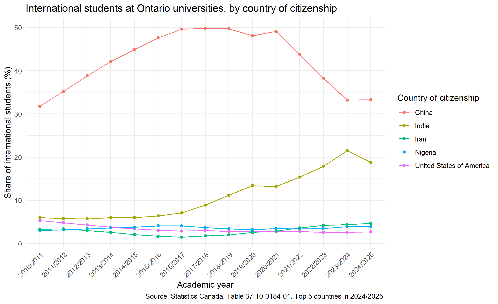
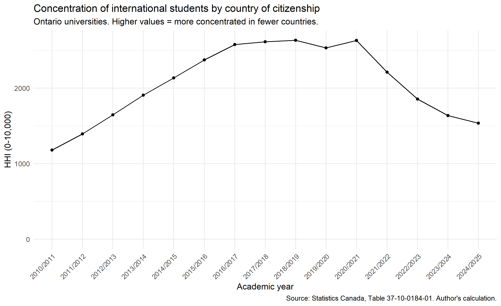
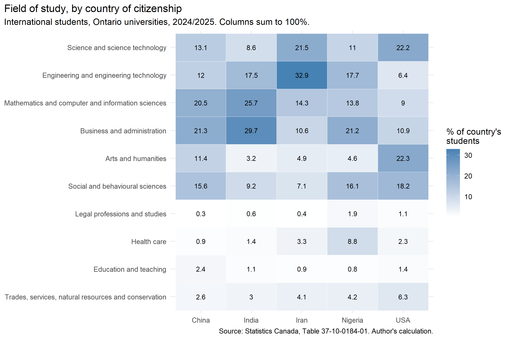
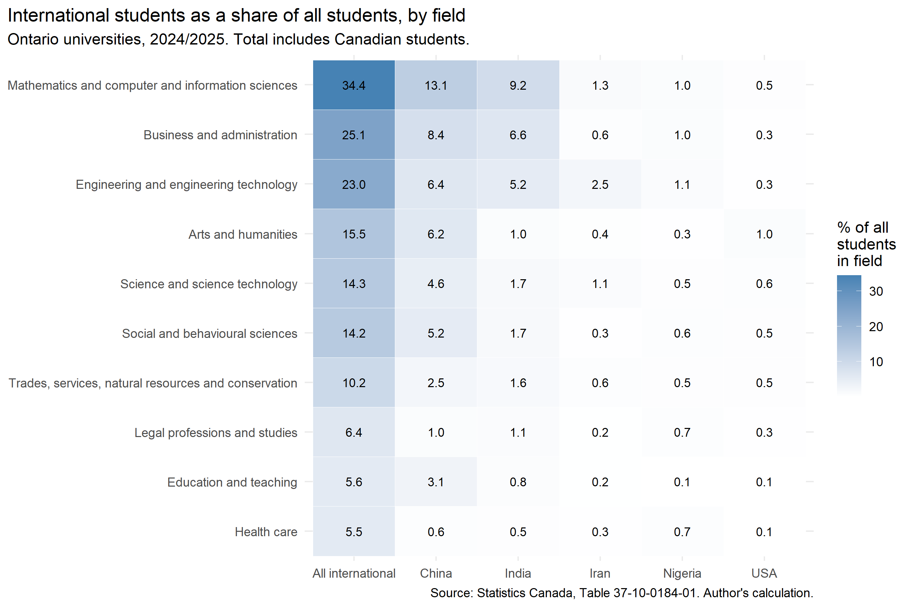
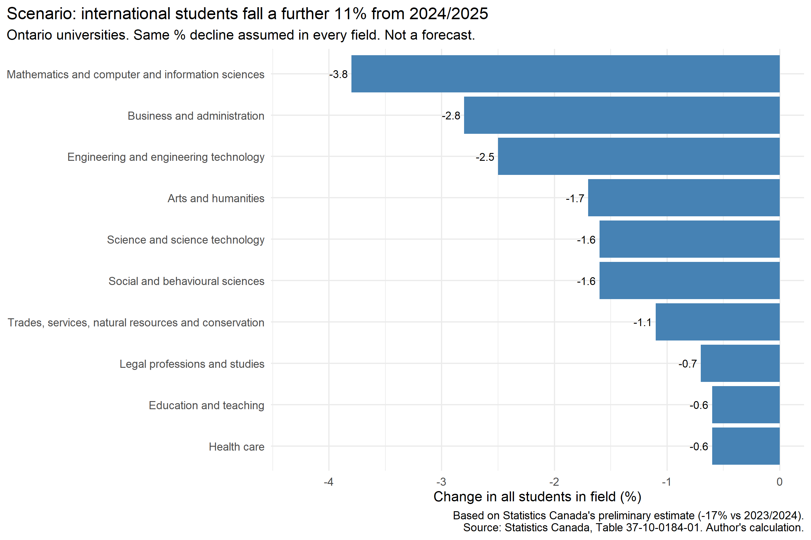
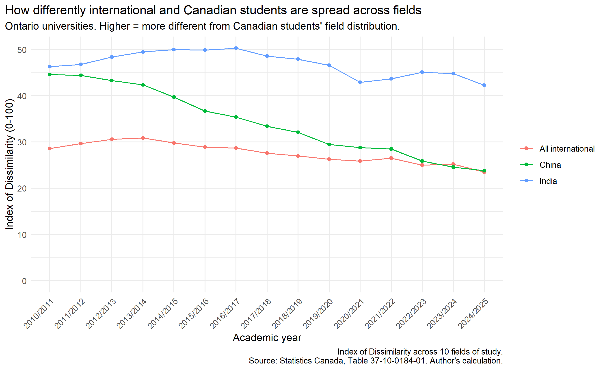

# International Students at Ontario Universities

Where international students at Ontario universities come from, what they
study, and which fields depend on them most (2010/2011 to 2024/2025).

## Why this matters

Canada has been reducing the number of study permits it issues to
international students. The federal target fell from 485,000 in 2024 to
437,000 in 2025 and 408,000 in 2026
([IRCC](https://www.canada.ca/en/immigration-refugees-citizenship/news/notices/2026-provincial-territorial-allocations-under-international-student-cap.html)).
Statistics Canada's preliminary estimate suggests international students at
Canadian universities fell by 17% from 2023/2024 to 2025/2026
([Statistics Canada](https://www150.statcan.gc.ca/n1/daily-quotidien/260505/dq260505b-eng.htm)).

University-wide totals do not show where this drop lands. Planning for
course sections, staffing and budgets happens at the level of programs and
faculties. This project asks three practical questions:

- **Which fields would feel a drop in international students the most?**
- **Is the risk tied to international students in general, or to one or two
  countries?**
- **How can a university compare its own programs to the Ontario picture?**
  The field-level shares here can serve as a provincial benchmark.

## Main finding

Across the field-level analyses, three fields stand out: mathematics and
computer science, business, and engineering. In 2024/2025, international
students made up 34.4% of all students in mathematics and computer science,
compared with 17.3% across all fields. In that field, Chinese and Indian
students alone made up 22.3% of all students. If international enrolment
keeps falling, these fields are likely to feel it the most, and changes in
one or two countries could matter a lot.

## What I looked at

1. **Country of citizenship.** How concentrated international students are
   by country, and how this has changed since 2010/2011. (Figures 1 and 2)

2. **Field of study by country of citizenship.** How students from the five
   largest source countries are spread across fields. (Figure 3)

3. **International students as a share of each field.** The total includes
   Canadian students, so the share shows how much each field depends on
   international students. Includes a simple "what if" scenario based on
   Statistics Canada's latest estimate. (Figures 4 and 5)

4. **International vs Canadian students across fields.** How differently the
   two groups are spread across fields, measured with the Index of
   Dissimilarity. (Figure 6)

## Data

- **Source:** Statistics Canada, Table 37-10-0184-01, *Postsecondary
  enrolments, by status of student in Canada, country of citizenship and
  Classification of Instructional Programs, STEM and BHASE groupings*.
- **What I used:** Ontario universities, 2010/2011 to 2024/2025, all levels
  of study combined, 10 fields of study.
- **How students are counted:** Students enrolled on one day in the fall
  term (between September 30 and December 1).
- **Rounding:** Statistics Canada randomly rounds all counts to a multiple
  of 3. Very small counts are not reliable, so I focus on larger groups.
- **Check:** The loaded data match a published Statistics Canada figure
  (international students at Canadian colleges, 2023/2024) within 30
  students. See `02_check.R`.

The full table (about 6 GB) is not included here. To run the code, download
the full table as CSV from
[Statistics Canada](https://www150.statcan.gc.ca/t1/tbl1/en/tv.action?pid=3710018401)
and put `37100184.csv` in the project folder.

## Findings

### 1. Country of citizenship

China was the largest source country in every year from 2010/2011 to
2024/2025. Chinese students made up about half of all international students
at Ontario universities from 2016/2017 to 2020/2021 (peak: 49.8% in
2017/2018), then fell to 33.3% by 2024/2025. Indian students rose from 6.0%
in 2010/2011 to 21.5% in 2023/2024, then fell to 18.8% in 2024/2025.

To summarize concentration across all 203 countries, I used the
Herfindahl-Hirschman Index (HHI): the sum of each country's squared share.
Higher values mean students come from fewer countries. HHI rose from 1,181 in
2010/2011 to a peak of 2,635 in 2018/2019, then fell to 1,537 in 2024/2025.
Put another way, in 2018/2019 the mix of students was as concentrated as if
they had come in equal numbers from about 4 countries. In 2024/2025, it was
about 6.5 countries.

Concentration is only part of the picture. International students also grew
as a share of all students, from 7.2% in 2010/2011 to 18.8% in 2023/2024
(17.3% in 2024/2025). So reliance on one country (China) was highest around
2020/2021, while reliance on international students overall kept rising
until 2023/2024.

### 2. Field of study by country of citizenship

Students from the largest source countries are spread across fields in
quite different ways. In 2024/2025, 72.9% of Indian students were in
business, mathematics and computer science, or engineering, compared with
53.8% of Chinese students. Iranian students were concentrated in engineering
(32.9%), and American students in arts and humanities (22.3%) and science
(22.2%). These shares are within each country, and the countries differ a
lot in size, so this figure shows patterns, not numbers of students.

### 3. International students as a share of each field

This is the most useful view for planning. Here the total includes Canadian
students. In 2024/2025, international students made up 34.4% of all students
in mathematics and computer science, 25.1% in business and 23.0% in
engineering. In mathematics and computer science, Chinese and Indian students
alone made up 22.3% of all students. At the other end, international
students made up 5.5% of students in health care and 5.6% in education.

Statistics Canada's preliminary estimate suggests international students at
Canadian universities fell by 17% from 2023/2024 to 2025/2026. For Ontario
universities, that would mean a further 11% drop from 2024/2025. If that drop
were the same in every field, mathematics and computer science would lose
3.8% of all its students, business 2.8% and engineering 2.5%. Health care
and education would lose 0.6%. This is a simple "what if" calculation, not a
forecast.

### 4. International vs Canadian students across fields

The Index of Dissimilarity shows how differently two groups are spread
across fields. A value of 23.5 means that 23.5% of international students
would need to change fields to match the field mix of Canadian students. The
index fell from 30.9 in 2013/2014 to 23.5 in 2024/2025.

This overall decline hides two different trends. Chinese students' fields
became much more like Canadian students' (44.6 in 2010/2011 to 23.8 in
2024/2025). Indian students' did not (46.3 to 42.3). In 2024/2025, only
three fields had a larger share of international students than Canadian
students: mathematics and computer science, business, and engineering.

## Limitations

- **All levels of study are combined.** Since January 2026, master's and
  doctoral students at public institutions are exempt from the federal cap
  on study permits. Future declines may fall more on fields with many
  undergraduate international students. I did not split the data by level.
- **Fields are broad.** Ten fields can hide differences within a field.
- **Small counts are unreliable** because of random rounding.
- **The scenario is simple.** It applies a national estimate to Ontario and
  assumes the same decline in every field. Fewer study permits reduce new
  students first, so total enrolment changes over several years.
- **The data show patterns, not causes.** They do not explain why
  enrolment changed.
- **"Canadian students"** is Statistics Canada's category. I did not confirm
  in the table notes whether it includes permanent residents.
- In Figure 6, Chinese students are also part of "All international," so
  the two lines are not independent.

## Files

| File | What it does |
|---|---|
| `01_load.R` | Loads the Statistics Canada CSV into a local DuckDB database |
| `02_check.R` | Checks the loaded data against a published figure |
| `03_q1_countries.R` | Country shares, HHI, international share of all students (Figures 1–2) |
| `04_q2_programs.R` | Field of study by country of citizenship (Figure 3) |
| `05_q3_exposure.R` | International share of each field and the scenario (Figures 4–5) |
| `06_q4_dissimilarity.R` | Index of Dissimilarity (Figure 6) |

**Tools:** R (DBI, duckdb, dplyr, ggplot2). Data are queried with SQL
through DuckDB. Run `01_load.R` once, then the other scripts in order.

## Note

Code and text were drafted with the help of an AI assistant. I chose the
questions and measures, checked every result against expected values, and
revised the interpretation.

Giyeon Seo
